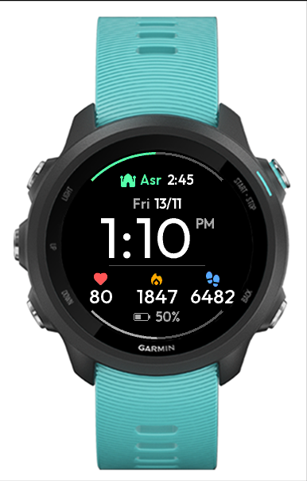

# Noor

Connect IQ watch face for the Garmin Forerunner 245 Music (`fr245m`, 240x240 round, 64 colours, API 3.3).

Shows the next prayer (Umm al-Qura method, from the watch's last known position) with a progress arc toward it, the time in 12h format, weekday and dd/mm date, heart rate, calories, steps and battery (as text and as a bottom arc).

## Toolchain (WSL)

- SDK and device files: [`connect-iq-sdk-manager-cli`](https://github.com/lindell/connect-iq-sdk-manager-cli) (`go install github.com/lindell/connect-iq-sdk-manager-cli@latest`, then `agreement accept`, `login`, `sdk set 9.3.0`, `device download -d fr245m -F`)
- Simulator: `docker build -t ciq-sim .` (Ubuntu 22.04, because the Linux SDK still needs `libwebkit2gtk-4.0`, which 24.04 dropped). It runs headless under Xvfb.
- Developer key: `~/.Garmin/developer_key.der`, outside the repo.

## Commands

- `tools/sim.sh test`: builds with `--unit-test` and runs the prayer-time tests in the simulator
- `tools/sim.sh shot [out.png]`: builds `bin/noor.prg` and screenshots the simulator
- `python3 tools/mkfont.py ...`: regenerates the BMFont files in `resources/fonts` (Outfit and Material Symbols Rounded, both from Google Fonts)

## Install on the watch

Copy `bin/noor.prg` to `GARMIN/APPS/` over USB (the watch shows up as an MTP device in File Explorer) and pick "Noor" from the watch faces. The file disappears from that folder once it's installed, which is expected. To capture debug output, create an empty `GARMIN/APPS/LOGS/NOOR.TXT`; crashes are logged to `GARMIN/APPS/LOGS/CIQ_LOG.YML`.
